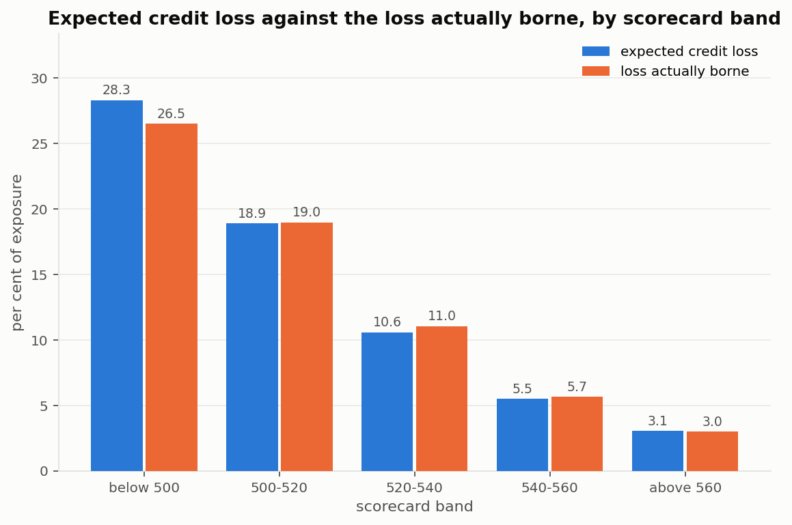
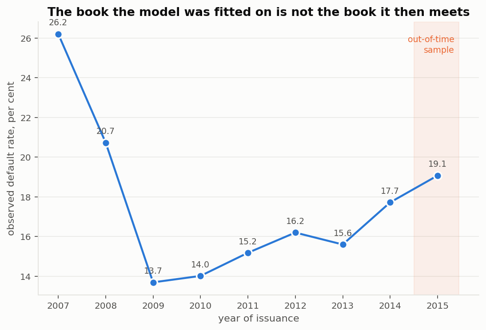
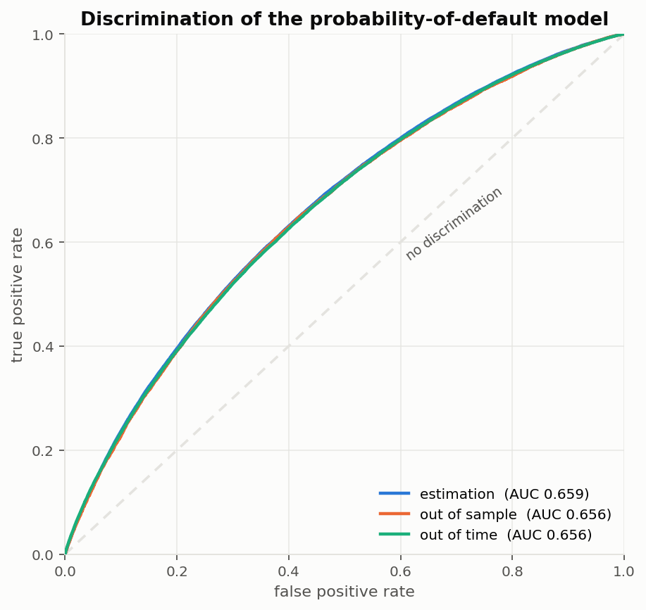
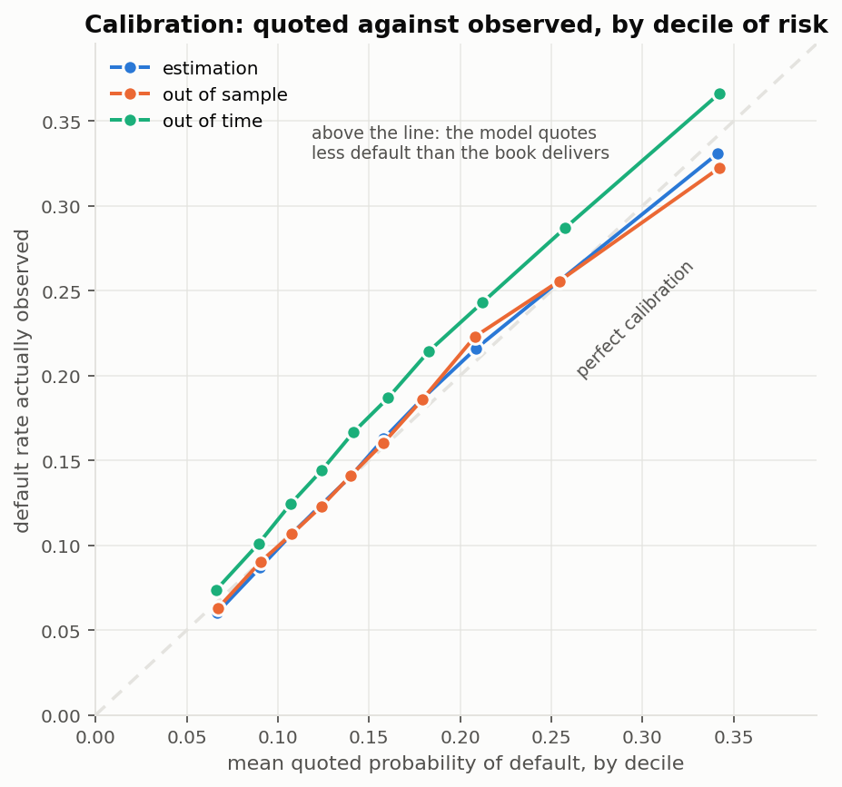
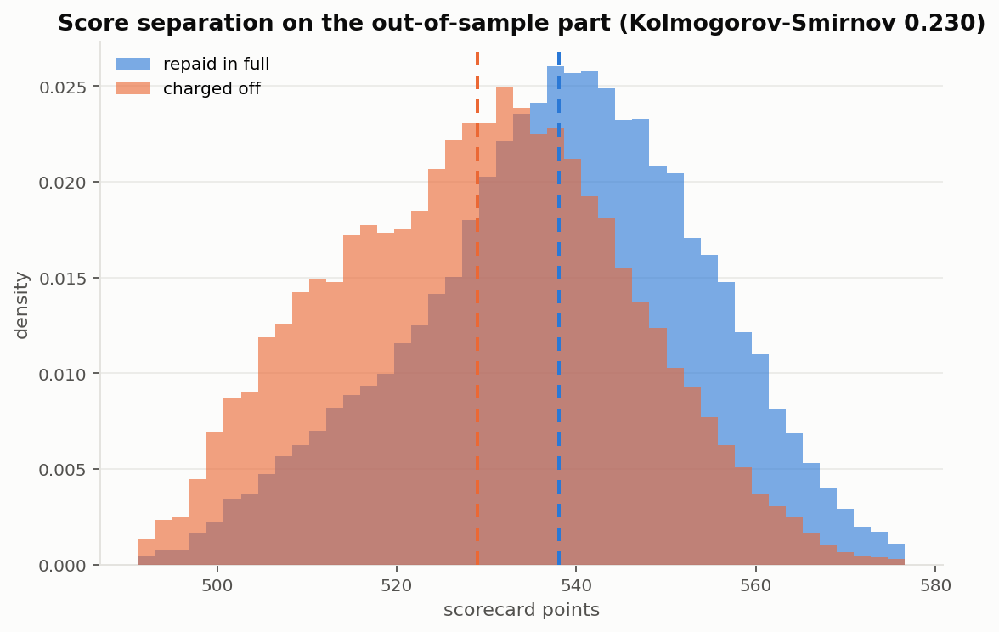
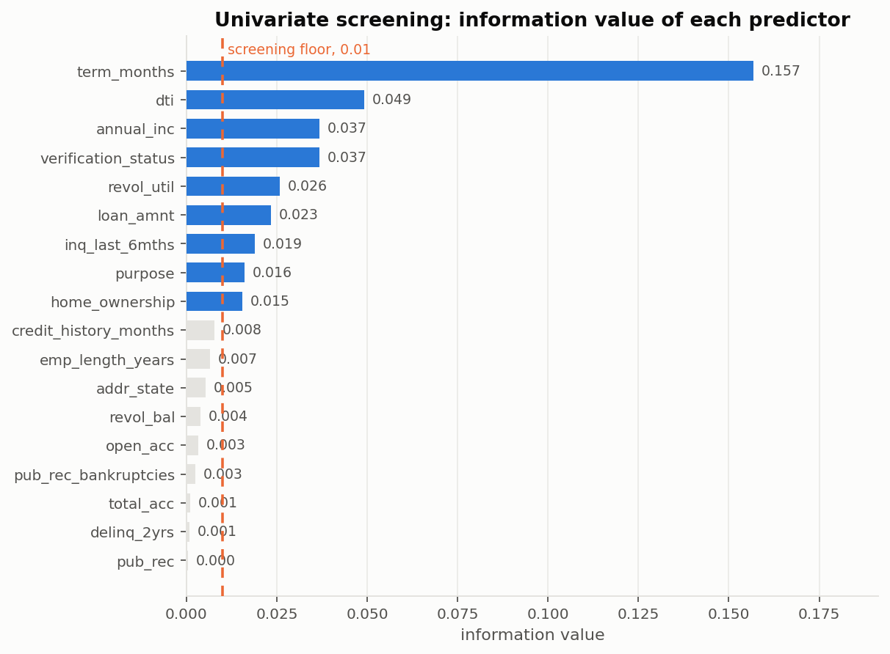

# Credit risk modelling on a consumer loan portfolio

A complete retail credit risk pipeline built end to end on 887 440 matured
consumer loans: probability of default, loss given default, exposure at
default, the expected credit loss that follows from the three, and the
scorecard a credit officer would actually apply.

Everything here runs from a clean checkout with no credentials. The data is
fetched from its original public source by a script in this repository.

```
Data      LendingClub loan-level files, issued 2007 to 2015
Sample    887 440 loans, all reached a terminal status, 158 150 defaults (17.82 %)
Stack     Python, pandas, statsmodels, scikit-learn, matplotlib
Models    PD (logistic on weight of evidence) · LGD (two stage) · EAD (credit conversion factor) · ECL
```

---

## The result that matters

A scorecard is useful when the loss it predicts is the loss the lender then
bears. Across the five bands of the scorecard, the expected credit loss tracks
the loss actually borne from 28 per cent of exposure down to 3 per cent.



| Scorecard band | Loans | Observed default rate | Expected loss | Loss borne |
|----------------|-------|----------------------|---------------|------------|
| below 500 | 12 463 | 41 % | 28.31 % | 26.52 % |
| 500 to 520 | 140 205 | 31 % | 18.88 % | 18.97 % |
| 520 to 540 | 348 924 | 20 % | 10.59 % | 11.05 % |
| 540 to 560 | 322 181 | 11 % | 5.49 % | 5.65 % |
| above 560 | 63 667 | 6 % | 3.05 % | 3.00 % |

Loss is expressed as a percentage of the amount granted. The full table is in
[`results/tables/ecl_by_score_band.md`](results/tables/ecl_by_score_band.md).

---

## How the sample is split

Two splits, because they answer different questions.

| Sample | Period | Loans | Default rate | Purpose |
|--------|--------|-------|--------------|---------|
| Estimation | 2007 to 2014 | 372 954 | 16.69 % | fit the models |
| Out of sample | 2007 to 2014 | 93 391 | 16.71 % | overfitting |
| Out of time | 2015 | 421 095 | 19.07 % | does it survive a later book |

The out-of-time split carries real weight here. The default rate climbs from
15.1 per cent in the 2007 to 2011 book to 19.1 per cent in the 2015 book, so a
model fitted on the earlier years meets a genuinely different portfolio, which
is the situation a scorecard faces in production.



---

## Probability of default

A logistic regression on weight-of-evidence transformed predictors. Predictors
are screened on information value, then eliminated backwards on significance.
Nine survive, with no collinearity worth reporting (largest variance inflation
factor 1.61).

| Sample | AUC | Gini | KS | Brier | Observed | Quoted |
|--------|-----|------|----|-------|----------|--------|
| Estimation | 0.6594 | 0.3187 | 0.2311 | 0.1328 | 16.69 % | 16.69 % |
| Out of sample | 0.6561 | 0.3122 | 0.2302 | 0.1332 | 16.71 % | 16.71 % |
| Out of time | 0.6565 | 0.3130 | 0.2263 | 0.1474 | 19.07 % | 16.83 % |



Discrimination barely moves between the three samples, which says the model is
not overfitted and that its ranking survives the later book. The level does
not: out of time the model quotes 16.83 per cent against 19.07 per cent
observed.



### The scorecard

The fitted model converts into a points table. Summing the points of a
borrower's classes reproduces the model's own score to within 2.48 points on a
scale running from 480 to 587, the residual being the rounding of each
attribute to an integer. The table is therefore the model rather than an
approximation of it. See [`results/tables/scorecard.md`](results/tables/scorecard.md).



---

## Loss given default

The recovery rate is zero for 18.6 per cent of defaulted loans and positive but
small for the rest, so the model is in two stages:

```
E[recovery rate] = P(recovery > 0) x E[recovery rate | recovery > 0]
LGD              = 1 - E[recovery rate]
```

Mean observed LGD is 0.911, which is what unsecured consumer lending looks
like.

| Sample | Stage 1 AUC | Combined R² | RMSE | Correlation |
|--------|-------------|-------------|------|-------------|
| Estimation | 0.6414 | 0.0200 | 0.0992 | 0.1415 |
| Out of sample | 0.6423 | 0.0161 | 0.1007 | 0.1277 |
| Out of time | 0.5880 | 0.0024 | 0.1134 | 0.1122 |

This is the weakest part of the pipeline and the section below says so plainly.

## Exposure at default

The credit conversion factor is the share of the granted amount still owed at
default, mean 0.636. A linear regression on the same binning classes, with
predictions clipped to the unit interval.

| Sample | R² | RMSE | Correlation |
|--------|----|------|-------------|
| Estimation | 0.0802 | 0.2301 | 0.2833 |
| Out of sample | 0.0821 | 0.2305 | 0.2866 |
| Out of time | 0.0888 | 0.2235 | 0.3062 |

Unlike the loss model, this one holds up out of time.

---

## Three things worth pointing out

**Keeping the lender's own grade out of the model.** LendingClub assigns every
loan a grade and an interest rate, both known at origination. Putting them in a
scorecard is tempting and raises the Gini from 0.313 to 0.400 out of time. But
the grade is the output of the platform's own risk model, so a scorecard built
on it largely re-estimates that model rather than the borrower's risk. The
headline model here uses borrower and loan characteristics only; the version
with the grade is kept as a benchmark in
[`results/tables/pd_model_comparison.md`](results/tables/pd_model_comparison.md),
and the gap between the two is a measure of how much the platform knows that
the application form does not say.

**A stable population and a mis-calibrated model are different problems.** The
population stability index between the estimation and out-of-time samples is
0.0017, far below any alert threshold: the borrowers of 2015 look like those of
earlier years. Yet the model under-predicts their default rate by 2.24
percentage points. What changed is not who applied but what happened to them.
Monitoring the population alone would have missed this entirely. Shifting the
intercept to the later book restores the level, leaves AUC, Gini and KS
unchanged to four decimals, and drops the Hosmer-Lemeshow statistic from 1655
to 61. Discrimination and calibration are separate properties and need separate
remedies.

**Counts of past delinquencies carry almost no signal, and that is informative.**
Number of public records, delinquencies in the past two years and bankruptcies
all come out with information values below 0.003. These are normally among the
strongest predictors of consumer default. They are flat here because the sample
contains only approved loans, and applicants with such records were largely
screened out before the data was recorded. This is range restriction induced by
the approval filter, and correcting it properly requires reject inference on
the declined applications, which are not in the public files. Any statement
about those variables from this sample would be about LendingClub's approval
policy, not about credit risk.



---

## Limitations

Stated plainly, because a model's weaknesses are part of its documentation.

- **Discrimination is modest.** A Gini of 0.31 is a real but limited ability to
  separate. Retail scorecards built on full bureau data typically reach 0.40 to
  0.60. The public files carry a thin set of borrower attributes and no bureau
  score, and the approval filter has already removed most of the easy cases.
- **The loss model does not transfer out of time.** Its out-of-time R² is
  0.0024, that is, barely better than quoting the average. Recovery behaviour
  on the 2015 book differs from the earlier years. A level recalibration lifts
  the R² to 0.0124 and removes the bias, but the honest reading is that
  recovery on unsecured consumer loans is close to unpredictable from
  origination data alone.
- **Default is defined at charge-off**, which LendingClub applies after 120
  days past due. The Basel reference definition is 90 days, so the indicator
  here is slightly conservative.
- **No reject inference.** Only approved loans are observed, as discussed above.
- **One lender, one country, one period.** Nothing here should be read as a
  general statement about consumer credit.

---

## Reproducing

```bash
git clone https://github.com/AnicetNzeu/credit-risk-modeling.git
cd credit-risk-modeling
pip install -r requirements.txt

python src/download_data.py    # 154 MB from the original public source
python src/prepare_data.py     # builds the modelling table
python src/pd_model.py         # PD, validation, scorecard
python src/lgd_ead_model.py    # LGD, EAD, expected credit loss
python src/figures.py          # figures
```

Raw data is not committed. The download script rebuilds it.

## Repository layout

```
src/
  download_data.py    fetch the four vintages
  prepare_data.py     cleaning, default definition, loss and exposure targets
  woe.py              weight-of-evidence binning and information value
  validation.py       AUC, Gini, KS, Hosmer-Lemeshow, Brier, PSI
  pd_model.py         probability of default, scorecard, recalibration
  lgd_ead_model.py    loss given default, exposure at default, expected loss
  figures.py          figures
  tables.py           Markdown table writer
results/
  tables/             every table referenced above, in Markdown and CSV
  figures/            every figure
```

## Data

LendingClub published loan-level files for its issued loans until 2019. The
four archives used here cover 2007 to 2015 and remain available at
`resources.lendingclub.com`. Every loan in them has reached a terminal status,
either repaid in full or charged off, so the default indicator is observed
throughout and no censoring correction is needed.

## About

A personal project, built to work through retail credit risk modelling end to
end on public data. It is not connected to any employer or client.

Anicet Nzeukoc, PhD candidate in financial econometrics, Université de
Montréal.
